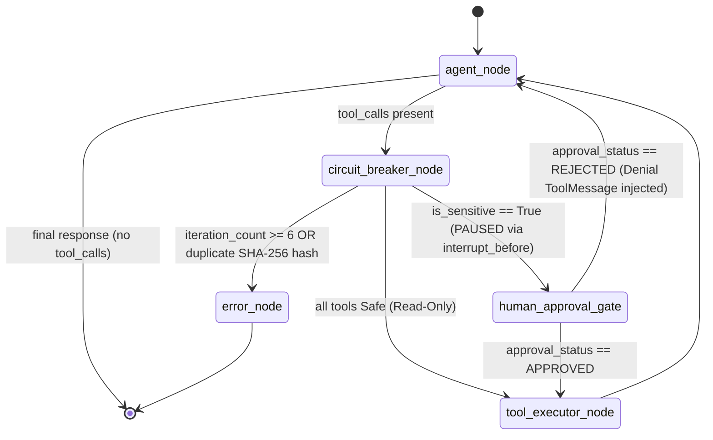

# State-Graph ReAct Agent with Short-Term Memory, Cycle Bounds & HITL

Enterprise Internal Cloud & Financial Operations ReAct Agent implemented with **LangGraph**, **MemorySaver Checkpointing**, **SHA-256 Normalized Payload Circuit Breaking**, and **Human-in-the-Loop (HITL)** approval gates.

## 1. System Architecture & State Graph Diagram



## 2. Installation & Setup (Python 3.11+ & uv)

```bash
git clone [https://github.com/eng-bahaeldin/stategraph-react-agent.git](https://github.com/eng-bahaeldin/stategraph-react-agent.git)
cd stategraph-react-agent
uv python pin 3.11
uv sync
cp .env.example .env  # Add OPENAI_API_KEY
```

## 3. State Schema & Tool Classification

### AgentState (`src/state.py`)
- `messages`: `Annotated[list[AnyMessage], add_messages]` — Reducer-managed conversational history.
- `iteration_count`: `int` — Enforces hard ceiling of `6` reasoning cycles.
- `executed_tool_hashes`: `list[str]` — Sequential SHA-256 hashes of canonicalized tool invocations.
- `pending_approval`: `Optional[dict]` — Metadata payload for paused sensitive tool calls.
- `approval_status`: `Optional[Literal["APPROVED", "REJECTED"]]` — Operator decision on resume.

### Tool Classification (`src/tools.py`)

| Tool Name | Risk Tier | `is_sensitive` | Operational Scope |
| :--- | :--- | :---: | :--- |
| `query_service_metrics(service_name)` | Safe (Read-Only) | `False` | Reads microservice error rates & P99 latency |
| `check_billing_balance(account_id)` | Safe (Read-Only) | `False` | Reads corporate operational account balance |
| `scale_kubernetes_cluster(service_name, replica_count)` | Sensitive (Mutation) | `True` | Mutates production Kubernetes replica count |
| `execute_wire_transfer(recipient_id, amount_usd)` | Sensitive (Financial) | `True` | Executes external vendor wire transfer |

## 4. Interruption & Resumption Protocol

1. **Detection & Interruption:** When `circuit_breaker_node` identifies a tool flagged with `is_sensitive=True` in `.metadata`, it populates `pending_approval` and routes to `human_approval_gate`. Because the graph is compiled with `interrupt_before=["human_approval_gate"]`, LangGraph suspends execution and persists `AgentState` to `MemorySaver` under the active `thread_id`.
2. **Operator Review:** The Streamlit UI inspects `graph.get_state(config).next`, detects `("human_approval_gate",)`, and renders the Approval Card displaying the tool name, arguments, and risk classification.
3. **Resumption:**
   - **Approve:** Calls `graph.update_state(config, {"approval_status": "APPROVED"})` and streams `None` to execute the sensitive tool and return to `agent_node`.
   - **Reject:** Calls `graph.update_state(config, {"approval_status": "REJECTED"})` and streams `None`. `human_approval_gate` injects an `AUTHORIZATION DENIED` `ToolMessage` so `agent_node` confirms cancellation without re-prompting.

## 5. Execution Commands

```bash
# Run automated QA test suite (7 tests)
uv run pytest -v

# Launch interactive Streamlit web dashboard
uv run streamlit run src/app.py
```

## 6. AI Audit Log Summary (`ai_prompt_log.md`)
- **Pure State Updates:** Replaced in-place list `.append()` mutations with pure dictionary returns to prevent checkpointer desynchronization.
- **Rejection Loop Prevention:** Injected explicit `ToolMessage` records on `REJECTED` decisions so the LLM terminates cleanly instead of re-proposing denied actions.
- **Canonical Payload Hashing:** Normalized tool argument keys via `json.dumps(..., sort_keys=True)` before SHA-256 hashing so key reordering cannot bypass duplicate call detection.
- **Thread Session Isolation:** Replaced global `thread_id` with per-session UUIDs in Streamlit `st.session_state`.
